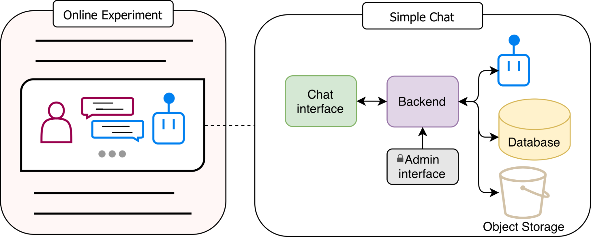
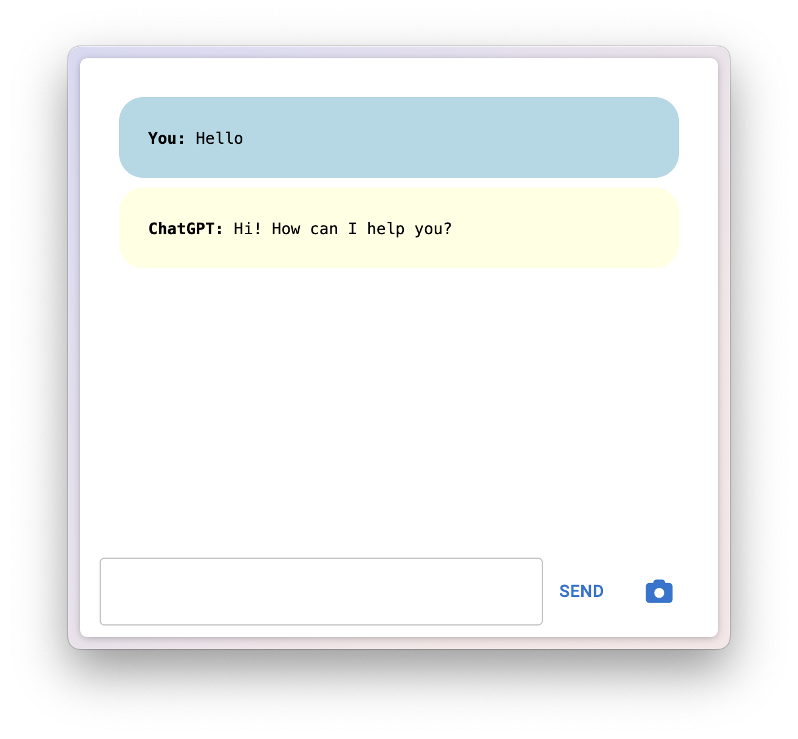

# Simple Chat

Simple Chat is a user-friendly web interface that facilitates and optimizes the integration of LLMs into online experiments. Simple Chat offers three core benefits:

1. An **embeddable chat interface** that eliminates the need for custom API coding,
1. a consistent interface **across survey platforms**, and
1. streaming responses that maintain conversational flow and reduce participant dropout.

Below are diagrams illustrating the architecture and chat interface:

<details><summary>Architecture</summary>
<p>

<!-- markdownlint-disable MD033 -->
<div align="center">

### Architecture <!-- markdownlint-disable-line MD001 -->



</p>
</details>

<details><summary>Chat interface</summary>
<p>

### Chat interface


</div>
<!-- markdownlint-enable MD033 -->

</p>
</details>

## Tutorial

[](https://youtu.be/M8G7-EQHCxc)

[Watch the tutorial video](https://youtu.be/M8G7-EQHCxc) for a first-time installation walkthrough.

## Requirements

- [Docker](https://docs.docker.com/get-docker/) with the [Docker Compose plugin](https://docs.docker.com/compose/install/) (`docker compose version` should print v2.20 or newer)
- An [OpenAI API key](https://platform.openai.com/api-keys)

All settings live in a single `.env` file in the repository root. Copy [`.env.example`](./.env.example) and fill in `OPENAI_API_KEY`, `DASHBOARD_USERNAME_ADMIN` (an email address) and `DASHBOARD_PASSWORD_ADMIN`. All other variables are optional and described in [`.env.example`](./.env.example) and [`settings.py`](./backend/src/models/settings.py).

## Quick Start (local)

Run Simple Chat on your computer and hold a first test conversation.

1. Clone the repository and create the `.env` file:

   ```bash
   git clone https://github.com/center-for-humans-and-machines/simple-chat.git
   cd simple-chat
   cp .env.example .env
   ```

1. In `.env`, set `OPENAI_API_KEY`, `DASHBOARD_USERNAME_ADMIN` and `DASHBOARD_PASSWORD_ADMIN`.

1. Start Simple Chat:

   ```bash
   docker compose --profile dev up --build
   ```

   The first build takes a few minutes. The chat frontend runs on <http://localhost:1234>, the dashboard on <http://localhost:3001> and the backend on <http://localhost:8000>. Press `Ctrl+C` to stop.

1. Open the dashboard and log in with `DASHBOARD_USERNAME_ADMIN` as email and `DASHBOARD_PASSWORD_ADMIN` in the project ID field.

1. Click **Create a new project**, enter a project ID (e.g. `my_study`), choose a model, write a system message and click **Create the project**.

1. On the project page, click **Open test chat** to chat with the model, or **Copy iframe code** to embed the chat in your survey, for example:

   ```html
   <iframe src="http://localhost:1234/?pid=my_study&participant_id=PARTICIPANT_ID" width="100%" height="600" style="border:none;"></iframe>
   ```

   Replace `PARTICIPANT_ID` with your survey platform's participant variable. See [Integrating Into Online Experiments](./docs/readme.md#integrating-into-online-experiments) for the optional query parameters.

1. Back on the project page, click **Download Conversations as JSON** to export the data.

## Production (single server)

To make Simple Chat reachable by participants, run it on one server, for example a virtual private server (VPS) with Docker installed. The `prod` profile builds the frontend and dashboard once and serves them with nginx.

1. Point three domain names at the server, for example `chat.example.com` (participants), `dashboard.example.com` (researchers) and `api.example.com` (backend).

1. Clone the repository on the server and create `.env` as above. In addition, set the public URLs:

   ```bash
   CHAT_URL=https://chat.example.com
   BACKEND_URL=https://api.example.com
   CORS_ALLOWED_ORIGINS=https://chat.example.com,https://dashboard.example.com
   TRUST_X_FORWARDED_FOR=true
   ```

   `CHAT_URL` and `BACKEND_URL` are built into the frontend and dashboard, so rebuild (step 3) after changing them.

1. Build and start Simple Chat in the background:

   ```bash
   docker compose --profile prod up --build --detach
   ```

   The chat frontend listens on port 8080, the dashboard on 8081 and the backend on 8000. The database is only reachable from the server itself.

1. Serve the three ports over HTTPS, which survey platforms require for iframes. For example, with [Caddy](https://caddyserver.com/docs/install) installed on the server, this `Caddyfile` obtains certificates automatically:

   ```text
   chat.example.com {
       reverse_proxy localhost:8080
   }
   dashboard.example.com {
       reverse_proxy localhost:8081
   }
   api.example.com {
       reverse_proxy localhost:8000
   }
   ```

Useful commands, run from the repository root:

```bash
docker compose --profile prod logs --follow     # show logs
docker compose --profile prod stop              # stop, keeping the data
git pull && docker compose --profile prod up --build --detach  # update
docker compose exec db mongodump --archive > backup.archive    # back up the database
docker compose --profile prod down --volumes    # remove everything, including the database
```

Replace `prod` with `dev` for the local setup. See [deployment](./docs/deployment.md) for details on the two profiles and on optional error tracking and LLM observability.

## Development

Refer to the [contributing](./contributing.md) documentation to set up a development environment for modifying the code.

## Usage

Refer to the [documentation](./docs/readme.md) folder for usage instructions.

## Participant Limits

Each project can limit how participants use the chat. Set the limits in the dashboard: open a project and click **Usage & limits**. They are stored on the project in MongoDB (`limits` field) and enforced by the backend. By default every limit is off, so new and existing projects behave as before.

| Limit                             | Default                             | Behavior                                                                                                                                                                                |
| --------------------------------- | ----------------------------------- | --------------------------------------------------------------------------------------------------------------------------------------------------------------------------------------- |
| Max conversations per participant | No limit                            | Conversations a `participant_id` has sent a message in. Rounds 2, 3, ... of a multi-round study do not count. Not applied without a `participant_id`; use the allowlist to require one. |
| Max turns per conversation        | No limit                            | Participant messages per conversation. Messages copied from earlier rounds do not count. The chat closes after the last allowed turn.                                                   |
| Token cap per conversation        | No limit                            | Prompt and completion tokens per conversation.                                                                                                                                          |
| Token cap per project             | No limit                            | Prompt and completion tokens across all conversations of the project. Once it is reached, no new conversations start and running ones end.                                              |
| Participant allowlist             | Empty (everyone may join)           | Participant IDs (e.g. Prolific IDs) allowed to start a conversation, one per line.                                                                                                      |
| Rate limit                        | No limit                            | Conversation starts and messages per window, see below.                                                                                                                                 |
| Rate limit window                 | 60 seconds                          | Length of the rate limit window, at most 86400 seconds (one day).                                                                                                                       |
| Rate limit counted per            | Participant ID                      | `Participant ID` counts per `participant_id`, falling back to the IP address when the URL has none. `IP address` counts per IP address.                                                 |
| Allowed embedding origins         | Empty (any site may embed the chat) | Origins allowed to show the chat in an iframe, e.g. `https://*.qualtrics.com`, see below.                                                                                               |

When a limit is reached, the participant sees a short message instead of an error, and the chat input closes. The message does not say which limit was reached. A rate-limited message is not sent: it goes back into the input field with a notice to wait. Chat token counts are estimates made with tiktoken, so a conversation can go slightly over its cap with the last reply.

**Rate limits behind a proxy.** By default the backend uses the address of the connection as the participant's IP. Behind a reverse proxy this is the proxy's address, so set `TRUST_X_FORWARDED_FOR=true` in `.env` to use the `X-Forwarded-For` header instead. Only enable it when a proxy sets this header, because participants can otherwise send their own.

**Restricting embedding.** With allowed embedding origins set, the production frontend sends a `Content-Security-Policy: frame-ancestors` header with these origins, so browsers refuse to show the chat in an iframe on any other site. The frontend container gets the policy from the backend at `BACKEND_INTERNAL_URL` (set to `http://backend:8000` in [`compose.yml`](./compose.yml)). Without `BACKEND_INTERNAL_URL` the header is not sent. In addition, the backend refuses to start a conversation when the chat reports being embedded on another origin, which also covers the development frontend. Opening the chat URL directly, outside an iframe, stays possible, for example for the dashboard's test chat.

**CORS.** `CORS_ALLOWED_ORIGINS` in `.env` limits which origins may call the backend. The default `*` allows all. Set it to the chat frontend and dashboard origins, e.g. `CORS_ALLOWED_ORIGINS=https://chat.example.com,https://dashboard.example.com`. The survey's origin is not needed, because the chat inside the iframe calls the backend from the frontend's origin.

## Citation

If you use Simple Chat in your research, please cite as follows:

- BibTeX:

  ```
  @misc{schettino2025facilitatingintegrationllmsonline,
        title={Facilitating the Integration of LLMs Into Online Experiments With Simple Chat},
        author={R. Bermudez Schettino and A. Dasmeh and L. Brinkmann},
        year={2025},
        eprint={2511.19123},
        archivePrefix={arXiv},
        primaryClass={cs.HC},
        url={https://arxiv.org/abs/2511.19123},
  }
  ```

- APA:

  Bermudez Schettino, R., Dasmeh, A., & Brinkmann, L. (2025). _Facilitating the Integration of LLMs Into Online Experiments With Simple Chat_. arXiv. https://doi.org/10.48550/arXiv.2511.19123

## Related

- Qualtrics example - [Download](https://drive.google.com/file/d/1cPyH_bUEBzdn5NsDzJvVUe9QytTyvbj3/view?usp=sharing).

  This Qualtrics template is a modified version of [Costello's Qualtrics template](https://publish.obsidian.md/qualtrics-documentation/Documentation+for+Using+the+Human-AI+Interaction+Qualtrics+File/Human-AI+interaction+Qualtrics+template+documentation).

- oTree example - [simple-chat-otree-walter-2025](https://github.com/center-for-humans-and-machines/simple-chat-otree-walter-2025)
- Readme template - [minimal-readme](https://github.com/rodrigobdz/minimal-readme)
- Format for `script` directory - [Shell Style Guide](https://github.com/rodrigobdz/styleguide-sh)
- See `healthcheck` Docker Compose file - [docker-compose-healthchecks](https://github.com/rodrigobdz/docker-compose-healthchecks)

## License

[CC BY 4.0](license)
