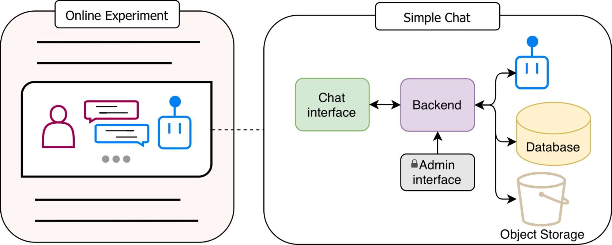
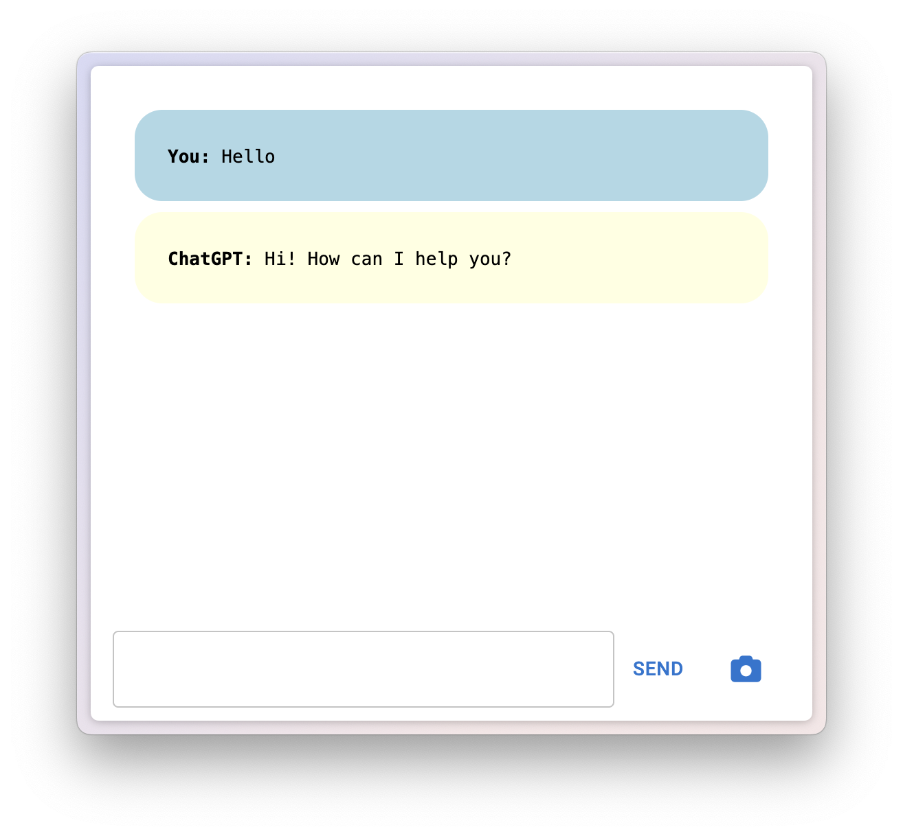

# Simple Chat

Simple Chat is a user-friendly web interface that facilitates and optimizes the integration of LLMs into online experiments. Simple Chat offers three core benefits:

1. An **embeddable chat interface** that eliminates the need for custom API coding,
1. a consistent interface **across survey platforms**, and
1. streaming responses that maintain conversational flow and reduce participant dropout.

Below are diagrams illustrating the architecture and chat interface:

<details><summary>Architecture</summary>
<p>

<!-- markdownlint-disable MD033 -->
<div align="center">

### Architecture <!-- markdownlint-disable-line MD001 -->



</p>
</details>

<details><summary>Chat interface</summary>
<p>

### Chat interface


</div>
<!-- markdownlint-enable MD033 -->

</p>
</details>

## Requirements

- Install [Docker](https://docs.docker.com/desktop/install/mac-install/) version `24.0.5, build ced0996` or newer
- Install [Docker Compose plugin](https://docs.docker.com/compose/install/linux/) version `v2.20.2-desktop.1` or newer
- Define secrets
  - Create `.env` file in the **backend** directory by copying the [`env.example`](./backend/env.example) file:

    ```bash
    cp backend/env.example backend/.env
    ```

    Variables are described in [`env.example`](./backend/env.example) and [`settings.py`](./backend/src/models/settings.py).
    Azure OpenAI, Together.ai and object storage (S3) variables can be left empty if not used; S3 is only needed for participant image uploads.

  - Create `.env` file in the **frontend** directory by copying the [`env.example`](./frontend/env.example) file:

    ```bash
    cp frontend/env.example frontend/.env
    ```

    The default values can be used for local development.

## Quick Start

Run Simple Chat locally and hold a first test conversation. You only need Docker and an OpenAI API key.

1. Clone the repository and create the `.env` files:

   ```bash
   git clone https://github.com/center-for-humans-and-machines/simple-chat.git
   cd simple-chat
   cp backend/env.example backend/.env
   cp frontend/env.example frontend/.env
   ```

1. In `backend/.env`, set `OPENAI_API_KEY`, `DASHBOARD_USERNAME_ADMIN` (an email address) and `DASHBOARD_PASSWORD_ADMIN`. All other variables are optional.

1. Start the development stack:

   ```bash
   docker compose --profile dev up --build
   ```

   The first build takes a few minutes. The chat frontend runs on <http://localhost:1234>, the dashboard on <http://localhost:3001> and the backend on <http://localhost:8000>.

1. Open the dashboard and log in with `DASHBOARD_USERNAME_ADMIN` as email and `DASHBOARD_PASSWORD_ADMIN` in the project ID field.

1. Click **Create a new project**, enter a project ID (e.g. `my_study`), choose a model, write a system message and click **Create the project**.

1. On the project page, click **Open test chat** to chat with the model, or **Copy iframe code** to embed the chat in your survey, for example:

   ```html
   <iframe src="http://localhost:1234/?pid=my_study&participant_id=PARTICIPANT_ID" width="100%" height="600" style="border:none;"></iframe>
   ```

   Replace `PARTICIPANT_ID` with your survey platform's participant variable. See [Integrating Into Online Experiments](./docs/readme.md#integrating-into-online-experiments) for the optional query parameters.

1. Back on the project page, click **Download Conversations as JSON** to export the data.

To make Simple Chat reachable by participants, deploy it to a server as described in the [deployment](./docs/deployment.md) documentation.

## Installation

- Refer to the [deployment](./docs/deployment.md) documentation for first-time installation.
- Refer to the [contributing](./contributing.md) documentation to set up a development environment for modifying the code.

## Usage

Refer to the [documentation](./docs/readme.md) folder for usage instructions.

## Citation

If you use Simple Chat in your research, please cite as follows:

- BibTeX:

  ```
  @misc{schettino2025facilitatingintegrationllmsonline,
        title={Facilitating the Integration of LLMs Into Online Experiments With Simple Chat},
        author={R. Bermudez Schettino and A. Dasmeh and L. Brinkmann},
        year={2025},
        eprint={2511.19123},
        archivePrefix={arXiv},
        primaryClass={cs.HC},
        url={https://arxiv.org/abs/2511.19123},
  }
  ```

- APA:

  Bermudez Schettino, R., Dasmeh, A., & Brinkmann, L. (2025). _Facilitating the Integration of LLMs Into Online Experiments With Simple Chat_. arXiv. https://doi.org/10.48550/arXiv.2511.19123

## Related

- Qualtrics example - [Download](https://drive.google.com/file/d/1cPyH_bUEBzdn5NsDzJvVUe9QytTyvbj3/view?usp=sharing).

  This Qualtrics template is a modified version of [Costello's Qualtrics template](https://publish.obsidian.md/qualtrics-documentation/Documentation+for+Using+the+Human-AI+Interaction+Qualtrics+File/Human-AI+interaction+Qualtrics+template+documentation).

- oTree example - [simple-chat-otree-walter-2025](https://github.com/center-for-humans-and-machines/simple-chat-otree-walter-2025)
- Readme template - [minimal-readme](https://github.com/rodrigobdz/minimal-readme)
- Format for `script` directory - [Shell Style Guide](https://github.com/rodrigobdz/styleguide-sh)
- See `healthcheck` Docker Compose file - [docker-compose-healthchecks](https://github.com/rodrigobdz/docker-compose-healthchecks)

## License

[CC BY 4.0](license)
